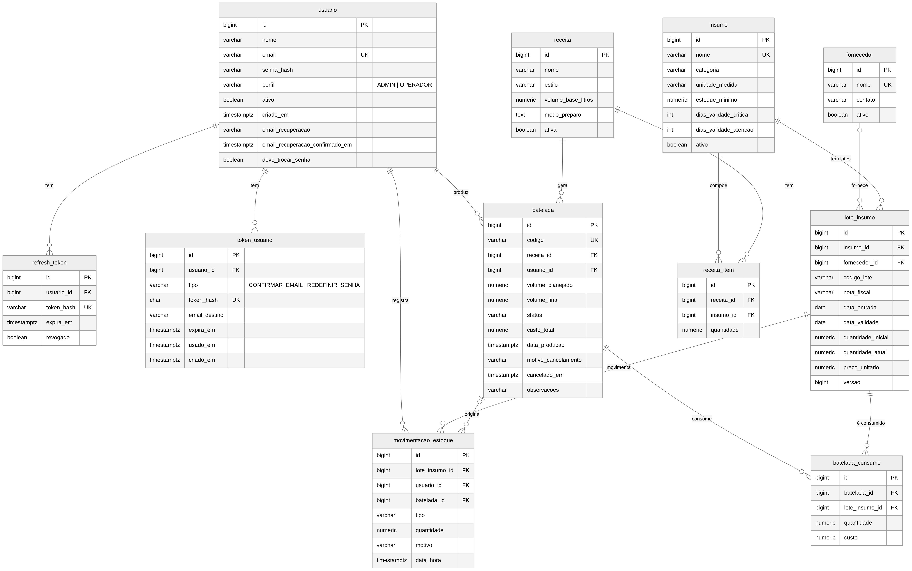

# Brassário: documentação técnica (DOC-2)

Esta parte da documentação descreve os **endpoints da API**, o **banco de dados** (DER e tabelas) e a **autenticação**
(login, JWT e perfis). Tudo foi levantado a partir do código do repositório (controllers, models, configurations do
EF Core, migrations e `Program.cs`). A visão geral e como executar o projeto estão no [README](../README.md).

## Sumário

1. [Visão geral da API](#1-visão-geral-da-api)
2. [Tabela de endpoints](#2-tabela-de-endpoints)
3. [Banco de dados](#3-banco-de-dados)
4. [Autenticação e perfis](#4-autenticação-e-perfis)
5. [Diferenças em relação à especificação](#5-diferenças-em-relação-à-especificação)

---

## 1. Visão geral da API

| Item | Valor |
|---|---|
| Prefixo | `/api/v1` (ex.: `http://localhost:5000/api/v1/armario`) |
| Formato | JSON (`application/json`) |
| Autenticação | `Authorization: Bearer <access token>` (JWT) |
| Documento OpenAPI | `/openapi/v1.json` e tela do Swagger em `/swagger` (**somente em ambiente Development**) |
| Total de rotas | 52 |

**Formato único de erro**

```json
{
  "timestamp": "2026-10-24T22:00:00Z",
  "status": 422,
  "codigo": "PERDA_MAIOR_QUE_SALDO",
  "mensagem": "A perda não pode ser maior que o saldo do lote.",
  "detalhes": [{ "campo": "quantidade", "erro": "..." }]
}
```

| Status | Quando acontece |
|---|---|
| 400 | Validação de campos (`detalhes` traz um item por campo) |
| 401 | Sem token, token inválido ou expirado (`NAO_AUTENTICADO`); login errado (`CREDENCIAIS_INVALIDAS`) |
| 403 | Sem permissão para a ação (`ACESSO_NEGADO`) ou troca de senha pendente (`TROCA_DE_SENHA_OBRIGATORIA`) |
| 404 | Recurso não encontrado |
| 409 | Conflito (ex.: nome ou e-mail repetido) |
| 422 | Regra de negócio (ex.: estoque insuficiente, perda maior que o saldo) |
| 429 | Muitas tentativas (`MUITAS_TENTATIVAS`) |

---

## 2. Tabela de endpoints

**Acesso:** `Público` não precisa de token; `Autenticado` aceita qualquer perfil logado (ADMIN ou OPERADOR);
`ADMIN` só o administrador. Quem ainda precisa trocar a senha temporária só consegue usar as rotas marcadas com **(*)**.

### Autenticação (`/auth`)

| Método | Rota | Descrição | Acesso |
|---|---|---|---|
| POST | `/auth/login` | Valida e-mail e senha; devolve o access token (JWT) e grava o refresh token em cookie | Público |
| POST | `/auth/refresh` | Renova a sessão a partir do cookie do refresh token (rotação) **(*)** | Público (cookie) |
| POST | `/auth/logout` | Revoga o refresh token e apaga o cookie **(*)** | Autenticado |
| GET | `/auth/me` | Dados da conta do usuário logado **(*)** | Autenticado |
| POST | `/auth/primeiro-acesso` | Troca a senha temporária por uma nova e, opcionalmente, cadastra o e-mail de recuperação **(*)** | Autenticado |
| POST | `/auth/confirmar-email` | Confirma o e-mail de recuperação pelo link recebido | Público |
| POST | `/auth/esqueci-senha` | Envia o link para redefinir a senha (sempre 202; limite de 3 por hora) | Público |
| POST | `/auth/redefinir-senha` | Define a senha nova a partir do link recebido | Público |
| POST | `/auth/alterar-senha` | Troca a senha do usuário logado e encerra as outras sessões | Autenticado |
| PUT | `/auth/email-recuperacao` | Troca o e-mail de recuperação e envia novo link de confirmação | Autenticado |
| POST | `/auth/reenviar-confirmacao` | Reenvia o link de confirmação do e-mail de recuperação | Autenticado |

### Usuários (`/usuarios`)

| Método | Rota | Descrição | Acesso |
|---|---|---|---|
| GET | `/usuarios` | Lista usuários (`busca`, `incluirInativos`) | ADMIN |
| GET | `/usuarios/{id}` | Detalha um usuário | ADMIN |
| POST | `/usuarios` | Cria usuário (perfil e senha temporária) | ADMIN |
| PUT | `/usuarios/{id}` | Edita nome, e-mail e perfil | ADMIN |
| PATCH | `/usuarios/{id}/status` | Ativa ou inativa o usuário | ADMIN |
| POST | `/usuarios/{id}/redefinir-senha` | Gera uma senha temporária (para quem não tem e-mail de recuperação) e encerra as sessões | ADMIN |

### Fornecedores (`/fornecedores`)

| Método | Rota | Descrição | Acesso |
|---|---|---|---|
| GET | `/fornecedores` | Lista fornecedores (`busca`) | Autenticado |
| GET | `/fornecedores/{id}` | Detalha um fornecedor | Autenticado |
| POST | `/fornecedores` | Cadastra fornecedor | ADMIN |
| PUT | `/fornecedores/{id}` | Edita nome e contato do fornecedor | ADMIN |

### Insumos (`/insumos`)

| Método | Rota | Descrição | Acesso |
|---|---|---|---|
| GET | `/insumos` | Lista insumos (`categoria`, `busca`, `incluirInativos`) | Autenticado |
| GET | `/insumos/resumo` | Saldo total, saldo utilizável, lotes, validade mais próxima e situação por insumo | Autenticado |
| GET | `/insumos/{id}` | Detalha um insumo | Autenticado |
| GET | `/insumos/{id}/lotes` | Lotes do insumo em ordem de uso (FEFO) | Autenticado |
| POST | `/insumos` | Cadastra insumo | ADMIN |
| PUT | `/insumos/{id}` | Edita insumo | ADMIN |
| PATCH | `/insumos/{id}/status` | Ativa ou inativa o insumo | ADMIN |

### Estoque: armário, entradas, lotes e movimentações

| Método | Rota | Descrição | Acesso |
|---|---|---|---|
| GET | `/armario` | Armário de Ingredientes: saldo, situação e próximo vencimento por insumo (`categoria`, `busca`, `incluirInativos`) | Autenticado |
| GET | `/armario/{insumoId}` | Detalhe do insumo com seus lotes em ordem FEFO | Autenticado |
| POST | `/entradas` | Entrada de estoque: lote novo, com insumo e/ou fornecedor novos na mesma transação | Autenticado |
| POST | `/lotes` | Registra um lote para um insumo existente (cria também a movimentação ENTRADA) | Autenticado |
| POST | `/lotes/{id}/perdas` | Registra perda do lote (baixa o saldo e grava a movimentação PERDA) | Autenticado |
| GET | `/movimentacoes` | Histórico de movimentações (`insumoId`, `loteId`, `producaoId`, `pagina`, `tamanho`) | Autenticado |

### Receitas (`/receitas`)

| Método | Rota | Descrição | Acesso |
|---|---|---|---|
| GET | `/receitas` | Lista receitas (`busca`, `incluirInativas`) | Autenticado |
| GET | `/receitas/{id}` | Ficha da receita com os ingredientes | Autenticado |
| POST | `/receitas` | Cria receita | ADMIN |
| PUT | `/receitas/{id}` | Edita receita | ADMIN |
| PATCH | `/receitas/{id}/status` | Ativa ou inativa a receita | ADMIN |
| GET | `/receitas/{id}/previa` | Prévia da produção: simula a baixa FEFO sem gravar (`quantidade`) | Autenticado |
| GET | `/receitas/{id}/disponibilidade` | Disponibilidade por ingrediente para um volume (`volume`), sem alterar o estoque | Autenticado |

### Produção (`/bateladas`)

| Método | Rota | Descrição | Acesso |
|---|---|---|---|
| GET | `/bateladas` | Lista produções (`de`, `ate`, `receitaId`, `status`, `pagina`, `tamanho`) | Autenticado |
| GET | `/bateladas/{id}` | Detalhe da produção (lotes consumidos, custo, rendimento) | Autenticado |
| GET | `/bateladas/{id}/consumos` | Lotes consumidos pela produção | Autenticado |
| POST | `/bateladas` | Produz uma batelada: baixa o estoque por FEFO em uma única transação | Autenticado |
| PATCH | `/bateladas/{id}/finalizar` | Registra o volume final e calcula o rendimento | Autenticado |
| POST | `/bateladas/{id}/cancelar` | Cancela a produção e estorna o estoque aos mesmos lotes (motivo de 5 a 255 caracteres) | Autenticado |

### Alertas, compras e dashboard

| Método | Rota | Descrição | Acesso |
|---|---|---|---|
| GET | `/alertas` | Alertas de validade e escassez (`tipo`, `severidade`, `limite`) | Autenticado |
| GET | `/compras/sugestao` | Insumos que acabam em até 15 dias ou estão abaixo do estoque mínimo | Autenticado |
| GET | `/dashboard/resumo` | Totais: insumos ativos, sem estoque, abaixo do mínimo, para compra, consumo em 30 dias | Autenticado |
| GET | `/dashboard/consumo` | Consumo de cada insumo nos últimos 30 dias | Autenticado |
| GET | `/dashboard/previsao` | Quantos dias o saldo de cada insumo dura, pelo ritmo de consumo | Autenticado |

---

## 3. Banco de dados

**SGBD:** PostgreSQL 16, acessado pelo EF Core (Npgsql). O esquema é criado e atualizado pelas **migrations**
(`backend/Brassario.Api/Data/Migrations`), que rodam sozinhas ao subir a API.

**Convenções**

- 11 tabelas, nomes e colunas em `snake_case`.
- Chaves primárias `BIGINT` com identidade automática.
- Enums gravados como **texto**, protegidos por `CHECK` (ex.: `perfil IN ('ADMIN','OPERADOR')`).
- Quantidades e valores em `NUMERIC` (nunca `float`): quantidades `NUMERIC(12,3)`, preço unitário `NUMERIC(12,4)`, custos `NUMERIC(14,2)` e `NUMERIC(14,4)`, volumes `NUMERIC(10,2)`.
- Datas de validade e de entrada em `DATE`; datas e horas em `TIMESTAMP WITH TIME ZONE` (UTC).
- Chaves estrangeiras com `ON DELETE RESTRICT` nas tabelas de estoque e produção (o histórico não se apaga); `CASCADE` em `refresh_token`, `token_usuario` e `receita_item`.
- Exclusão lógica: usuário, insumo e fornecedor usam `ativo`; receita usa `ativa`.

### 3.1 Diagrama Entidade-Relacionamento (DER)



O mesmo diagrama está em [`der-brassario.svg`](der-brassario.svg) (vetor, para ampliar) e o código-fonte editável, em
Mermaid, em [`der.mmd`](der.mmd) (pode ser aberto em <https://mermaid.live>).

**Relacionamentos (1:N)**

| Pai | Filho | Significado |
|---|---|---|
| `usuario` | `refresh_token`, `token_usuario` | Sessões e links de e-mail do usuário |
| `usuario` | `batelada`, `movimentacao_estoque` | Quem produziu e quem movimentou o estoque |
| `fornecedor` | `lote_insumo` | Quem forneceu o lote (opcional) |
| `insumo` | `lote_insumo`, `receita_item` | Lotes do insumo e receitas que o usam |
| `receita` | `receita_item`, `batelada` | Ingredientes da receita e produções feitas com ela |
| `batelada` | `batelada_consumo`, `movimentacao_estoque` | Lotes consumidos e movimentações geradas pela produção |
| `lote_insumo` | `batelada_consumo`, `movimentacao_estoque` | Consumos e movimentações do lote |

### 3.2 Descrição das tabelas

#### `usuario`: pessoas que acessam o sistema

| Coluna | Tipo | Restrição | Descrição |
|---|---|---|---|
| id | BIGINT | PK | Identificador |
| nome | VARCHAR(120) | NOT NULL | Nome da pessoa |
| email | VARCHAR(160) | NOT NULL, UNIQUE | E-mail de login |
| senha_hash | VARCHAR(100) | NOT NULL | Hash BCrypt da senha (a senha nunca é guardada) |
| perfil | VARCHAR(10) | CHECK (`ADMIN`, `OPERADOR`) | Perfil de acesso |
| ativo | BOOLEAN | NOT NULL | Usuário inativo não consegue entrar |
| criado_em | TIMESTAMPTZ | NOT NULL | Data do cadastro |
| email_recuperacao | VARCHAR(160) | NULL | E-mail usado para recuperar a senha |
| email_recuperacao_confirmado_em | TIMESTAMPTZ | NULL | Quando o e-mail de recuperação foi confirmado |
| deve_trocar_senha | BOOLEAN | DEFAULT false | Senha temporária: exige troca no primeiro acesso |

#### `refresh_token`: sessões renováveis

| Coluna | Tipo | Restrição | Descrição |
|---|---|---|---|
| id | BIGINT | PK | Identificador |
| usuario_id | BIGINT | FK → usuario, CASCADE | Dono da sessão |
| token_hash | VARCHAR(100) | NOT NULL, UNIQUE | SHA-256 do token (o token em si só existe no cookie) |
| expira_em | TIMESTAMPTZ | NOT NULL | Fim da validade (30 dias) |
| revogado | BOOLEAN | NOT NULL | Token já usado ou encerrado |

#### `token_usuario`: links de confirmação de e-mail e de redefinição de senha

| Coluna | Tipo | Restrição | Descrição |
|---|---|---|---|
| id | BIGINT | PK | Identificador |
| usuario_id | BIGINT | FK → usuario, CASCADE | Dono do link |
| tipo | VARCHAR(30) | CHECK (`CONFIRMAR_EMAIL`, `REDEFINIR_SENHA`) | Finalidade do link |
| token_hash | CHAR(64) | NOT NULL, UNIQUE | SHA-256 do token (hexadecimal) |
| email_destino | VARCHAR(160) | NULL | E-mail que está sendo confirmado (só em `CONFIRMAR_EMAIL`) |
| expira_em | TIMESTAMPTZ | NOT NULL | 24 h (confirmar e-mail) ou 30 min (redefinir senha) |
| usado_em | TIMESTAMPTZ | NULL | Preenchido quando o link é usado (uso único) |
| criado_em | TIMESTAMPTZ | NOT NULL | Data de criação |

Índice: `ix_token_usuario_usuario_tipo (usuario_id, tipo)`.

#### `fornecedor`: quem vende os insumos

| Coluna | Tipo | Restrição | Descrição |
|---|---|---|---|
| id | BIGINT | PK | Identificador |
| nome | VARCHAR(120) | NOT NULL, UNIQUE (`uq_fornecedor_nome`) | Nome do fornecedor |
| contato | VARCHAR(160) | NULL | Telefone ou e-mail |
| ativo | BOOLEAN | NOT NULL | Só fornecedores ativos aparecem na entrada de estoque (ainda não há rota para inativar) |

#### `insumo`: matéria-prima (malte, lúpulo, levedura...)

| Coluna | Tipo | Restrição | Descrição |
|---|---|---|---|
| id | BIGINT | PK | Identificador |
| nome | VARCHAR(120) | NOT NULL, UNIQUE (`uq_insumo_nome`) | Nome do insumo |
| categoria | VARCHAR(15) | CHECK (`MALTE`, `LUPULO`, `LEVEDURA`, `ADJUNTO`, `OUTRO`) | Categoria |
| unidade_medida | VARCHAR(5) | CHECK (`KG`, `G`, `L`, `ML`, `UN`) | Unidade em que o saldo é medido |
| estoque_minimo | NUMERIC(12,3) | CHECK ≥ 0 | Abaixo deste saldo aparece o alerta de estoque baixo |
| dias_validade_critica | INTEGER | CHECK ≥ 0 (padrão 15) | Dias para vencer que marcam Validade Crítica |
| dias_validade_atencao | INTEGER | CHECK ≥ dias_validade_critica (padrão 45) | Dias para vencer que marcam atenção |
| ativo | BOOLEAN | NOT NULL | Insumo inativo sai do Armário |

#### `lote_insumo`: cada entrada de estoque (o saldo é controlado por lote)

| Coluna | Tipo | Restrição | Descrição |
|---|---|---|---|
| id | BIGINT | PK | Identificador |
| insumo_id | BIGINT | FK → insumo, RESTRICT | Insumo do lote |
| fornecedor_id | BIGINT | FK → fornecedor, RESTRICT, NULL | Fornecedor (opcional) |
| codigo_lote | VARCHAR(40) | NOT NULL | Código da embalagem (maiúsculas); único por insumo |
| nota_fiscal | VARCHAR(30) | NULL | Número da nota fiscal |
| data_entrada | DATE | NOT NULL | Quando o lote chegou |
| data_validade | DATE | CHECK ≥ data_entrada | Validade do lote |
| quantidade_inicial | NUMERIC(12,3) | CHECK > 0 | Quantidade recebida |
| quantidade_atual | NUMERIC(12,3) | CHECK ≥ 0 e ≤ quantidade_inicial | Saldo atual (nunca negativo) |
| preco_unitario | NUMERIC(12,4) | CHECK ≥ 0 | Preço por unidade de medida |
| versao | BIGINT | concorrência | Incrementa a cada mudança de saldo |

Índices: `uq_lote_insumo_codigo (insumo_id, codigo_lote)` único, `ix_lote_insumo_insumo_validade (insumo_id, data_validade)` e `ix_lote_insumo_validade (data_validade)`, usados para ordenar por FEFO e gerar alertas.

#### `movimentacao_estoque`: histórico de tudo que entra ou sai de um lote

| Coluna | Tipo | Restrição | Descrição |
|---|---|---|---|
| id | BIGINT | PK | Identificador |
| lote_insumo_id | BIGINT | FK → lote_insumo, RESTRICT | Lote movimentado |
| usuario_id | BIGINT | FK → usuario, RESTRICT | Quem fez a movimentação |
| batelada_id | BIGINT | FK → batelada, RESTRICT, NULL | Produção que originou (saída ou estorno) |
| tipo | VARCHAR(15) | CHECK (`ENTRADA`, `SAIDA_PRODUCAO`, `AJUSTE`, `PERDA`, `ESTORNO`) | Tipo |
| quantidade | NUMERIC(12,3) | NOT NULL | Positiva entra, negativa sai |
| motivo | VARCHAR(255) | CHECK: obrigatório (mín. 5 caracteres) em `AJUSTE` e `PERDA` | Justificativa |
| data_hora | TIMESTAMPTZ | NOT NULL | Quando aconteceu |

Índice: `ix_movimentacao_lote_data (lote_insumo_id, data_hora)`.

#### `receita`: ficha da receita

| Coluna | Tipo | Restrição | Descrição |
|---|---|---|---|
| id | BIGINT | PK | Identificador |
| nome | VARCHAR(120) | NOT NULL | Nome da receita |
| estilo | VARCHAR(80) | NULL | Estilo da cerveja |
| volume_base_litros | NUMERIC(10,2) | NOT NULL | Volume para o qual as quantidades foram escritas |
| modo_preparo | TEXT | NULL | Passo a passo |
| ativa | BOOLEAN | NOT NULL | Receita inativa não aparece para produzir |

#### `receita_item`: ingredientes da receita

| Coluna | Tipo | Restrição | Descrição |
|---|---|---|---|
| id | BIGINT | PK | Identificador |
| receita_id | BIGINT | FK → receita, CASCADE | Receita |
| insumo_id | BIGINT | FK → insumo, CASCADE | Ingrediente |
| quantidade | NUMERIC(12,3) | NOT NULL | Quantidade para o volume base (escalada na produção) |

#### `batelada`: produção de uma receita

| Coluna | Tipo | Restrição | Descrição |
|---|---|---|---|
| id | BIGINT | PK | Identificador |
| codigo | VARCHAR(20) | NOT NULL, UNIQUE (`uq_batelada_codigo`) | Código legível, ex.: B-2026-0012 |
| receita_id | BIGINT | FK → receita, RESTRICT | Receita produzida |
| usuario_id | BIGINT | FK → usuario, RESTRICT | Responsável |
| volume_planejado | NUMERIC(10,2) | CHECK > 0 | Litros planejados |
| volume_final | NUMERIC(10,2) | CHECK > 0 ou NULL | Litros medidos ao finalizar (até 2× o planejado) |
| status | VARCHAR(15) | CHECK (`EM_ANDAMENTO`, `FINALIZADA`, `CANCELADA`) | Situação |
| custo_total | NUMERIC(14,2) | CHECK ≥ 0 | Soma dos custos dos lotes consumidos (0 se cancelada) |
| data_producao | TIMESTAMPTZ | NOT NULL | Data da produção (índice `ix_batelada_data_producao`) |
| motivo_cancelamento | VARCHAR(255) | NULL | Preenchido só quando cancelada |
| cancelado_em | TIMESTAMPTZ | NULL | Preenchido só quando cancelada (`ck_batelada_cancelamento`) |
| observacoes | VARCHAR(255) | NULL | Anotações livres |

#### `batelada_consumo`: de quais lotes cada produção tirou ingredientes

| Coluna | Tipo | Restrição | Descrição |
|---|---|---|---|
| id | BIGINT | PK | Identificador |
| batelada_id | BIGINT | FK → batelada, RESTRICT | Produção |
| lote_insumo_id | BIGINT | FK → lote_insumo, RESTRICT | Lote de onde saiu |
| quantidade | NUMERIC(12,3) | CHECK > 0 | Quantidade consumida |
| custo | NUMERIC(14,4) | CHECK ≥ 0 | Quantidade × preço unitário do lote |

Esta tabela permite o **estorno** do cancelamento: a quantidade volta exatamente aos lotes de origem.

---

## 4. Autenticação e perfis

### 4.1 Login

1. O cliente envia `POST /api/v1/auth/login` com `{ "email": "...", "senha": "..." }`.
2. A API busca o usuário pelo e-mail (sem diferenciar maiúsculas) e confere a senha com BCrypt.
3. E-mail inexistente, senha errada e usuário inativo recebem a **mesma resposta** (`401 CREDENCIAIS_INVALIDAS`), para não revelar qual foi o erro.
4. Em caso de sucesso, a API devolve no corpo o access token e os dados do usuário, e grava o refresh token em cookie:

```json
{
  "accessToken": "eyJhbGciOi...",
  "tokenType": "Bearer",
  "expiresIn": 1800,
  "usuario": { "id": 1, "nome": "Administrador", "email": "admin@brassario.com", "perfil": "ADMIN", "ativo": true },
  "deveTrocarSenha": false,
  "emailRecuperacaoConfirmado": false
}
```

5. Nas demais chamadas, o cliente envia `Authorization: Bearer <accessToken>`.

### 4.2 JWT (access token)

| Item | Valor |
|---|---|
| Algoritmo | HMAC SHA-256 (chave simétrica, mínimo de 32 caracteres, definida em `JWT_KEY` no `.env`) |
| Validade | 30 minutos (`Jwt:ExpiresMinutes`) |
| Emissor e audiência | `brassario` |
| Claims | `sub` (id do usuário), `email`, `role` (perfil), `jti` (id único do token) e, só quando há senha temporária, `pwd_change` |
| Validação | `AddJwtBearer` confere assinatura, emissor, audiência e validade (tolerância de 30 s) em toda requisição |
| Onde fica no front | Só em memória (nunca em `localStorage`) |

### 4.3 Refresh token e sessão

- **Token:** 48 bytes aleatórios, em base64url. No banco fica **apenas o hash SHA-256** (`refresh_token.token_hash`).
- **Cookie:** `brassario_refresh`, `HttpOnly` (JavaScript não lê), `Secure` e `SameSite=Strict`, validade de 30 dias.
- **Renovação:** `POST /auth/refresh` (sem corpo) usa o cookie. O token usado é **revogado** e um novo é emitido (rotação). Token revogado, vencido ou de usuário inativo recebe 401.
- **Logout:** `POST /auth/logout` revoga o refresh token do usuário e apaga o cookie. O access token em si continua válido até vencer (limitação do JWT sem estado; por isso ele dura só 30 minutos).
- **No frontend:** quando uma chamada recebe 401, o cliente HTTP tenta renovar uma vez e repete a chamada; se falhar, leva o usuário ao login.

### 4.4 Senhas

- Hash **BCrypt** com fator de custo 11.
- Mínimo de 8 caracteres e máximo de 72 bytes (limite do BCrypt).
- O cadastro de usuário (ADMIN) gera uma **senha temporária**: no primeiro login, o token traz `pwd_change` e a API bloqueia tudo (`403 TROCA_DE_SENHA_OBRIGATORIA`) exceto `/auth/refresh`, `/auth/logout`, `/auth/me` e `/auth/primeiro-acesso`. A nova senha precisa ser diferente da temporária.
- **Esqueci minha senha:** `POST /auth/esqueci-senha` responde sempre 202 com a mesma mensagem (exista a conta ou não). O link vale **30 minutos**, é de **uso único** e é enviado ao e-mail de recuperação confirmado. Limite de **3 pedidos por hora** por e-mail e por IP (`429 MUITAS_TENTATIVAS`).
- **Confirmação do e-mail de recuperação:** link com validade de 24 horas, também de uso único.
- Os links são guardados como hash SHA-256 em `token_usuario`; o link em si só existe no e-mail.
- **Alterar senha** (logado) confere a senha atual (`422 SENHA_ATUAL_INCORRETA`) e encerra as sessões dos outros aparelhos.

### 4.5 Perfis e permissões

Há dois perfis, gravados em `usuario.perfil` e carregados do claim `role` do token. A API valida em cada rota com
`[Authorize]` (qualquer perfil logado) ou `[Authorize(Roles = "ADMIN")]`. O frontend só esconde o que o perfil não pode
usar (`ProtectedRoute`); a decisão final é **sempre da API**.

| Funcionalidade | ADMIN | OPERADOR |
|---|:---:|:---:|
| Login, trocar a própria senha, ver a própria conta | ✔ | ✔ |
| Consultar Armário, insumos, fornecedores, receitas, alertas, compras sugeridas e dashboard | ✔ | ✔ |
| Registrar entrada de estoque e perda de lote | ✔ | ✔ |
| Produzir, finalizar e cancelar produção | ✔ | ✔ |
| Cadastrar e editar insumos | ✔ | ✘ |
| Cadastrar e editar fornecedores | ✔ | ✘ |
| Criar e editar receitas | ✔ | ✘ |
| Gerenciar usuários (criar, editar, ativar/inativar, redefinir senha) | ✔ | ✘ |

Respostas de erro: **401** sem token ou token inválido/expirado; **403** com token válido, mas sem permissão
(`ACESSO_NEGADO`).

### 4.6 Outras proteções

- **Rate limit** no "esqueci minha senha" (por IP e por e-mail) e no reenvio de confirmação.
- Mensagens de erro iguais para conta inexistente e senha errada.
- Logs sem senha nem links com token; a senha não aparece nem no `ToString()` dos objetos de requisição.
- Segredos (senha do banco e `JWT_KEY`) em variáveis de ambiente (`.env` fora do repositório; o modelo é o `.env.example`).
- Swagger e OpenAPI ligados só em Development.

**Usuário de teste:** o seed cria o ADMIN `admin@brassario.com` (senha `Admin@2026`). O OPERADOR só entra no seed com
`Seed__IncluirOperador=true`; caso contrário, o ADMIN o cadastra pela tela **Usuários**.

---

## 5. Diferenças em relação à especificação

A especificação técnica (seções 2 e 3) foi o ponto de partida. O que foi implementado difere nestes pontos:

| Tema | Especificação | Implementado |
|---|---|---|
| Tabelas | 10 | 11: foi acrescentada `token_usuario` (links de confirmação de e-mail e de redefinição de senha) |
| `usuario` | Sem recuperação de senha | Colunas `email_recuperacao`, `email_recuperacao_confirmado_em` e `deve_trocar_senha` |
| `batelada` | Sem cancelamento | Colunas `motivo_cancelamento` e `cancelado_em`, status `CANCELADA` e `CHECK` próprio |
| `lote_insumo` | Sem nota fiscal | Coluna `nota_fiscal` |
| Rotas de lote | `GET /lotes`, `GET /lotes/{id}`, `POST /lotes/{id}/ajustes` | Não implementadas; o detalhe e a lista de lotes saem por `/armario/{insumoId}` e `/insumos/{id}/lotes` |
| Entrada de estoque | Só `POST /lotes` | Também `POST /entradas` (cria insumo e fornecedor novos junto, na mesma transação) |
| Acesso de entradas e produção | "ADMIN, OPERADOR" | Qualquer usuário autenticado (hoje só existem esses dois perfis, o efeito é o mesmo) |
| Rotas extras | n/d | `/dashboard/*`, `/compras/sugestao`, `/movimentacoes`, `/receitas/{id}/previa` e `/receitas/{id}/disponibilidade` |
| Autenticação | Login, refresh, logout, me | Também primeiro acesso, confirmação de e-mail, esqueci/redefinir/alterar senha e e-mail de recuperação |
